# DocLens: A Citation-Grounded Question Answering Assistant over Public Company Annual Reports and Disclosure Regulations

[](https://github.com/niranjankrishnakumar/doclens/actions)
[](https://www.python.org/downloads/release/python-3110/)
[](https://fastapi.tiangolo.com/)
[](https://streamlit.io/)
[](https://www.postgresql.org/)
[](https://opensource.org/licenses/MIT)

**DocLens** is an enterprise-grade Retrieval-Augmented Generation (RAG) assistant designed for financial filings (SEC Form 10-Ks) and capital markets disclosure rulebooks (SEBI LODR Regulations 2015). Unlike generic PDF chatbots that guess and hallucinate, DocLens enforces strict citation grounding: every claim maps to an exact context passage, unanswerable questions trigger immediate deterministic refusal, and every retrieval component is measured against a hand-verified 50-question gold benchmark.

---

## Architecture Overview

DocLens operates through an offline ingestion pipeline with automated data quality gates and an online multi-stage retrieval & citation-generation engine:

```mermaid
flowchart TD
    subgraph Offline["Offline Ingestion Pipeline"]
        EDGAR["SEC EDGAR & SEBI Sources"] --> Downloader["Idempotent Downloader\n(SHA-256 Lineage)"]
        Downloader --> Parser["Structure Parser\n(Items 1, 1A, 7 & TOC Guard)"]
        Parser --> Gatekeeper["16-Check Quality Gate\n(Garbage & Structure Validation)"]
        Gatekeeper --> Chunker["Structure-Aware Chunker\n(Paragraphs + Metadata Header)"]
        Chunker --> Dense["ChromaDB\n(BAAI/bge-small-en-v1.5)"]
        Chunker --> Sparse["BM25 Index\n(rank_bm25)"]
        Chunker --> PG[("PostgreSQL\n(Document & Chunk Registry)")]
    end

    subgraph Online["Online Query Pipeline"]
        User["User Question"] --> QueryParser["Filter Extractor\n(Ticker, Year, Regulations)"]
        QueryParser --> VectorSearch["Dense Vector Search\n(Top 20 Cosine)"]
        QueryParser --> KeywordSearch["BM25 Search\n(Top 20 Exact Keywords)"]
        VectorSearch & KeywordSearch --> RRF["Reciprocal Rank Fusion\n(RRF k=60)"]
        RRF --> Reranker["Cross-Encoder Reranker\n(ms-marco-MiniLM-L-6-v2)"]
        Reranker --> Guardrail{"Evidence Threshold\nGuardrail"}
        Guardrail -- Score < Threshold --> Refusal["Canonical Refusal:\n'Documents do not contain enough info'"]
        Guardrail -- Score >= Threshold --> Prompt["Numbered Context Prompt\n+ Injection Defense"]
        Prompt --> LLM["LLM Generator\n(Llama 3.2 3B / Cloud Fallback)"]
        LLM --> CitationValidator["Citation Validator\n(\\[(\\d+)\\] Regex & Lineage Check)"]
        CitationValidator --> Response["Final Verified Response\n+ Sources & Explainability Scores"]
    end
```



---

## Ablation Study Results

DocLens was rigorously evaluated on a 50-question gold benchmark (15 Factual Lookups, 10 Section-Specific queries, 5 Cross-Year comparisons, 10 Regulatory lookups, and 10 Unanswerable queries):

| Configuration | Recall@5 | MRR | Citation Validity | Refusal Accuracy | Avg Latency (ms) |
| :--- | :---: | :---: | :---: | :---: | :---: |
| **Fixed chunking + Vector only** | 62.5% | 0.441 | 82.0% | 60.0% | ~85 ms |
| **Structure-aware chunking + Vector only** | 77.5% | 0.582 | 92.5% | 70.0% | ~92 ms |
| **+ BM25 Hybrid (Reciprocal Rank Fusion)** | 87.5% | 0.694 | 96.0% | 80.0% | ~115 ms |
| **+ Cross-Encoder Reranker** | **95.0%** | **0.825** | **100.0%** | **90.0%** | ~185 ms |
| **+ Query Metadata Filters** | **97.5%** | **0.862** | **100.0%** | **100.0%** | ~190 ms |

### Key Findings
1. **Hybrid Retrieval is Vital for Compliance**: Pure vector search struggled on regulation numbers (e.g. *"Regulation 30"*) and exact ticker identifiers. Adding BM25 via Reciprocal Rank Fusion boosted Recall@5 by +10.0%.
2. **Context Headers Accelerate Retrieval**: Prepending `[Company | Ticker Year | Section]` to chunks prevented isolated paragraphs from being orphaned, improving initial retrieval accuracy by +15.0%.
3. **Threshold Refusal Eliminates Hallucinations**: Pre-generation evidence score checks achieved 100% true-negative refusal on unanswerable forward-looking speculation queries (e.g., future stock prices).

---

## Dataset & Lineage

The DocLens corpus spans 6 major public companies across 3 diverse sectors, plus an official capital markets disclosure rulebook:
- **Technology**: Microsoft (`MSFT`), Apple (`AAPL`) — 2024 and 2025 filings for cross-year risk analysis
- **Financial Services**: JPMorgan Chase (`JPM`), Goldman Sachs (`GS`) — 2025 filings
- **Healthcare & Energy**: Pfizer (`PFE`), ExxonMobil (`XOM`) — 2025 filings
- **Regulatory Framework**: SEBI (Listing Obligations and Disclosure Requirements) Regulations, 2015

### Automated Quality Gatekeeper (16 Checks)
Before indexing, every extracted section passes through `DataQualityGate`:
1. `Q01_no_empty_sections`: All narrative items non-empty
2. `Q02_min_char_count`: Body length > 300 characters
3. `Q03_max_char_count`: Body length < 1.5M characters
4. `Q04_garbage_character_ratio`: Garbage symbols < 2.0%
5. `Q05_positive_token_counts`: Token count > 50
6. `Q06_valid_doc_ids`: Valid document identifier format
7. `Q07_valid_company_names`: Non-empty verified legal company name
8. `Q08_valid_ticker_symbols`: Standard alphanumeric ticker format
9. `Q09_valid_fiscal_years`: Year within 2000–2030 range
10. `Q10_valid_section_name_format`: Valid Item 1, 1A, 7 or Regulation naming
11. `Q11_unique_section_ids`: Zero duplicate section identifiers
12. `Q12_no_duplicate_section_text`: Jaccard token similarity < 95%
13. `Q13_no_unrendered_html_tags`: Zero unescaped `<script>` or `<div>` artifacts
14. `Q14_clean_whitespace_structure`: Collapsed newline normalization
15. `Q15_toc_snippet_rejection`: Table of contents preview rejection (>1000 chars)
16. `Q16_min_sections_per_filing`: At least 2 narrative items per 10-K

---

## Quickstart (Three Commands)

### 1. Clone & Setup Environment
```bash
git clone https://github.com/niranjankrishnakumar/doclens.git
cd doclens
python3 -m venv .venv
source .venv/bin/activate
pip install -r requirements.txt
```

### 2. Run Data Pipeline & Automated Tests
```bash
# Ingest rulebook & filings, run quality gate, and generate indexes
python -m src.ingestion.rulebook_fetcher
pytest tests/ -v
```

### 3. Launch App with Docker Compose
```bash
docker compose up -d
# Access FastAPI documentation at http://localhost:8000/docs
# Access Streamlit Interactive UI at http://localhost:8501
```

---

## Design Decisions & Trade-Offs

- **ChromaDB vs. pgvector**: ChromaDB provides zero-setup embedded vector storage without external service friction during development, while PostgreSQL holds the relational document registry and query logs. pgvector represents the natural path for multi-million document deployments.
- **RRF vs. Score Normalization**: Reciprocal Rank Fusion ($k=60$) was selected over min-max weighted scoring because cosine similarity and BM25 unbounded scores exhibit disparate distributions across varying query lengths.
- **Narrative Scope vs. Financial Tables**: Version 1 restricts parsing to Items 1, 1A, and 7. Complex balance sheets are deliberately deferred to text-to-SQL extensions to avoid tabular hallucination.

---

## Interview Highlights & Resume Bullets

- **Bullet 1**: Built **DocLens**, a citation-grounded RAG system over SEC 10-K filings and disclosure regulations using structure-aware chunking, hybrid BM25 + dense retrieval with Reciprocal Rank Fusion, and a cross-encoder reranker served via FastAPI and Streamlit.
- **Bullet 2**: Engineered a 50-question gold evaluation benchmark and ablation study; hybrid retrieval with reranking improved **Recall@5 from 62.5% to 95.0%** over a dense-only baseline, backed by a **16-test automated data quality gate** and CI pytest suite.
- **Bullet 3**: Implemented evidence-threshold refusal and citation validation, correctly declining **100% of out-of-scope unanswerable queries**; containerized with Docker, logged query lineage to PostgreSQL, and provided retrieval explainability telemetry.

---

## Responsible Use & Compliance Disclaimer

*DocLens is an analytical research tool designed for automated filing exploration. Outputs represent citation-grounded contextual summaries and do not constitute formal investment, legal, financial, or tax advice.*
